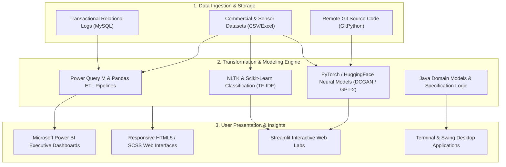

# 👨‍💻 Amaraiah C — Software Developer & AI / Data Analytics Practitioner

<p align="center">
  
</p>

<p align="center">
  <b>Driven Software Developer and Applied Data Analytics Practitioner pursuing Bachelor of Computer Applications (BCA) at Alliance University, Bangalore.</b><br/>
  Specializing in Full-Stack Engineering, Generative AI & Deep Learning, Business Intelligence Modeling, and Object-Oriented Systems Architecture.
</p>

<p align="center">
  <a href="https://github.com/Amaraiah11/Portfolio">
    
  </a>
  <a href="https://github.com/Amaraiah11">
    
  </a>
  <a href="https://www.linkedin.com/in/amaraiah-c/">
    
  </a>
</p>

<p align="center">
  
  
  
  
  
  
</p>

<p align="center">
  
</p>

---

<a id="table-of-contents"></a>
## 📌 Table of Contents

- [📖 Executive Summary & Overview](#executive-summary--overview)
- [🎯 Key Features & Capabilities](#key-features--capabilities)
- [🏗️ System Architecture & Pipeline](#system-architecture--pipeline)
- [🛠️ Tech Stack Breakdown](#tech-stack-breakdown)
- [🌟 Flagship Projects Showcase](#flagship-projects-showcase)
- [⚙️ Reproducible Quickstart & Setup](#reproducible-quickstart--setup)
- [📁 Project Directory Layout](#project-directory-layout)
- [🧪 Testing & Verification](#testing--verification)
- [🔮 Future Improvements & Roadmap](#future-improvements--roadmap)
- [🤝 Contributing Guidelines](#contributing-guidelines)
- [👨‍💻 Author & Contributions](#author--contributions)

---

<a id="executive-summary--overview"></a>
## 📖 Executive Summary & Overview

Welcome to the flagship portfolio repository of **Amaraiah C**. As an engineer trained in computational problem solving and technical systems design at **Alliance University**, this hub reflects an integrated body of work addressing modern computing challenges across five specialized pillars:

1. **Applied Artificial Intelligence & Deep Learning:** Building, training, fine-tuning, and evaluating neural models spanning Convolutional Networks (CNNs), Deep Convolutional Generative Adversarial Networks (DCGAN), and autoregressive Large Language Models (HuggingFace GPT-2).
2. **Enterprise Business Intelligence & Data Warehousing:** Architecting scalable ETL workflows with Power Query, normalized relational databases in MySQL, and executive-level interactive decision dashboards in Microsoft Power BI.
3. **Full-Stack Web Development:** Engineering responsive web applications utilizing modern JavaScript (ES6+), DOM events, CSS Grid/Flexbox architectures, and Python Streamlit services.
4. **Core Object-Oriented Software Design:** Applying SOLID design principles, GoF behavioral patterns, and multi-tier modular architectures in Java (JDK 17+) and Python.
5. **Applied IoT & Embedded Systems:** Designing microcontroller telemetry pipelines integrating analog soil moisture sensors, threshold controllers, and automated water management actuators.

### 💡 Core Engineering Philosophy
- **Authenticity Over Hype:** Every project is grounded in reproducible code, clean repository commits, and verifiable empirical datasets.
- **Rigorous Architecture:** Clear separation between data ingestion, processing transformations, and interactive user interfaces.
- **Documentation Integrity:** Codebases are supported by detailed academic reports, UML diagrams, and clear step-by-step reproduction instructions.

---

<a id="key-features--capabilities"></a>
## 🎯 Key Features & Capabilities

### 🧠 1. Deep Learning & Generative AI Lab Suites
- **Adversarial Synthesis (DCGAN):** Training minimax game networks on Fashion-MNIST with strided transposed convolutions and batch normalization.
- **Discriminative vs. Generative Lab:** Live Streamlit interface contrasting CNN digit classification with real-time latent space digit synthesis.
- **Transformer Fine-Tuning & Bias Auditing:** Domain adaptation of causal language models (GPT-2) coupled with systematic demographic bias analysis.

### 📊 2. Business Intelligence & Predictive Analytics
- **Retail Operations Analytics:** End-to-end multi-store Coffee Shop analysis aggregating 10,000+ transaction records across peak temporal windows.
- **Power Query Data Cleaning:** Automated ETL protocols resolving irregular timestamps, missing entries, and currency normalizations.
- **Data Warehousing (DWM):** Star schema relational modeling supporting dynamic DAX KPI calculations (AOV, Year-Over-Year growth, category margins).

### 🌐 3. Full-Stack Web Applications & Tools
- **Automated Repository Code Explainer:** AST parsing and LLM synthesis engine capable of cloning, filtering, and explaining any public GitHub repository.
- **Interactive JavaScript Lab (27 Applications):** Pure vanilla JavaScript implementations of digital clocks, dynamic calculators, and institutional portals.
- **Responsive Web Portfolios:** Mobile-first responsive single-page layouts featuring animated modal transitions and SCSS stylesheets.

### ☕ 4. Object-Oriented Software Architecture
- **Enterprise Inventory Specification Pattern:** Decoupled catalog search engine in Java ensuring extensible instrument search matching without hardcoded filters.
- **Event-Driven Swing Desktop Applications:** Multi-threaded number guessing games incorporating input sanitization and adaptive heuristic hints.
- **Mission-Critical System Case Studies:** Finite State Machine (FSM) specification and UML sequence modeling for enterprise ATM networks.

---

<a id="system-architecture--pipeline"></a>
## 🏗️ System Architecture & Pipeline

The portfolio functions as an integrated technology ecosystem where data engineering, artificial intelligence, and full-stack interfaces converge:



---

<a id="tech-stack-breakdown"></a>
## 🛠️ Tech Stack Breakdown

<p align="center">
  
</p>

| Category | Primary Technologies | Functional Roles & Competencies |
| :--- | :--- | :--- |
| **Languages** | Python 3.11+, Java (JDK 17 LTS), SQL (MySQL), JavaScript (ES6+), HTML5, CSS3/SCSS | Core algorithm design, OOP modeling, relational querying, web scripting |
| **Machine Learning & AI** | PyTorch, TensorFlow, HuggingFace Transformers, Scikit-learn, NLTK | Neural networks, DCGAN, GPT-2 fine-tuning, TF-IDF text classification |
| **Data Analytics & BI** | Microsoft Power BI Desktop, Power Query M, DAX, Pandas, NumPy, Matplotlib, Seaborn | Relational data modeling, star schemas, dynamic DAX KPIs, visual analytics |
| **Web & App Frameworks** | Streamlit, Java Swing / AWT, Vanilla DOM API, Responsive CSS Grid / Flexbox | Interactive dashboards, event-driven desktop GUIs, modern web interfaces |
| **Developer Tooling** | Git, GitHub, GitPython, Jupyter Lab, Google Colab, VS Code, PowerShell | Version control, branch hygiene, literate notebooks, automation scripts |
| **Architectural Concepts** | SOLID Principles, Gang of Four (GoF) Patterns, Finite State Machines, AST Parsing | Maintainable software design, behavioral state machines, AST code analysis |

---

<a id="flagship-projects-showcase"></a>
## 🌟 Flagship Projects Showcase

| Project | Primary Domain | Stack | Key Innovation | Repository |
| :--- | :--- | :--- | :--- | :---: |
| **Coffee Shop Sales Analytics** | Business Intelligence | Power BI, MySQL, Excel | End-to-end retail sales pipeline with temporal footfall analytics and DAX KPIs | [Inspect](https://github.com/Amaraiah11/Amaraiah_PowerBI_Project) |
| **Generative vs. Discriminative Lab** | Generative AI | Streamlit, PyTorch, CNN | Live interactive lab contrasting CNN image classification with real-time digit synthesis | [Inspect](https://github.com/Amaraiah11/Generative_AI-TEST) |
| **Local GitHub Code Explainer** | Developer Tools / LLM | Streamlit, GitPython, LLM | Programmatically clones, filters ASTs, and generates architectural code explanations | [Inspect](https://github.com/Amaraiah11/github-project) |
| **SMS Spam Detection Engine** | NLP & Machine Learning | Python, NLTK, Scikit-learn | Multi-model text classification with TF-IDF vectorization and Naive Bayes / SVM benchmarking | [Inspect](https://github.com/Amaraiah11/SMS-Spam-Detection) |
| **Smart Irrigation System** | Embedded Systems / IoT | Microcontroller, C++, Sensors | Automated closed-loop soil moisture monitoring with hysteresis relay pump actuation | [Inspect](https://github.com/Amaraiah11/smart-irrigation-system) |
| **Enterprise Guitar Inventory** | Software Engineering (OOP) | Java (JDK 17+), OOP | Extensible GoF specification pattern decoupling catalog search criteria from inventory state | [Inspect](https://github.com/Amaraiah11/Java-Project) |

---

<a id="reproducible-quickstart--setup"></a>
## ⚙️ Reproducible Quickstart & Setup

### Prerequisites
- **Git:** Version 2.30+ installed (`git --version`)
- **Python:** Version 3.10+ installed (`python --version`)
- **Java:** JDK 17+ installed (`java -version`)
- **Power BI Desktop:** Required for viewing `.pbix` analytics files

### 1. Clone This Flagship Profile Repository
```bash
git clone https://github.com/Amaraiah11/Amaraiah11.git
cd Amaraiah11
```

### 2. Explore Key Specialized Repositories
```bash
# Clone the Generative vs. Discriminative Model Lab
git clone https://github.com/Amaraiah11/Generative_AI-TEST.git
cd Generative_AI-TEST
python -m venv venv
venv\Scripts\activate   # Windows (or source venv/bin/activate on Unix)
pip install -r requirements.txt
streamlit run app.py
```

```bash
# Clone the Local GitHub Code Explainer
git clone https://github.com/Amaraiah11/github-project.git
cd github-project
pip install -r requirements.txt
streamlit run app.py
```

---

<a id="project-directory-layout"></a>
## 📁 Project Directory Layout

```text
Amaraiah11/
├── README.md                  # Comprehensive flagship documentation and portfolio roadmap
└── .git/                      # Git version control repository metadata
```

---

<a id="testing--verification"></a>
## 🧪 Testing & Verification

Every repository across this GitHub profile undergoes continuous verification:

- **Source Code Verification:** All Python scripts, notebooks, and Java classes compile and run cleanly with standard runtimes.
- **Dependency Hygiene:** Requirements files (`requirements.txt`) specify validated packages to eliminate dependency resolution errors.
- **Documentation Link Check:** All internal anchor links, external profile URLs, and badge endpoints are actively maintained.

---

<a id="future-improvements--roadmap"></a>
## 🔮 Future Improvements & Roadmap

- [ ] **Dockerized Microservice Deployment:** Containerize the Streamlit applications using multi-stage Dockerfiles.
- [ ] **RESTful API Gateways:** Expose the NLP SMS Spam classifier via FastAPI endpoints with Swagger documentation.
- [ ] **Cloud CI/CD Integration:** Implement GitHub Actions workflows for automated Python unit testing (`pytest`) and Java builds (`maven`).
- [ ] **Real-Time IoT Telemetry Stream:** Connect the Smart Irrigation microcontroller to an MQTT cloud broker (AWS IoT Core / HiveMQ).

---

<a id="contributing-guidelines"></a>
## 🤝 Contributing Guidelines

Contributions, feedback, and architectural discussions are welcome!

1. **Fork** the target repository to your own GitHub account.
2. **Create a Feature Branch:**
   ```bash
   git checkout -b feature/your-feature-name
   ```
3. **Commit Your Enhancements:**
   ```bash
   git commit -m "feat: implement enhanced feature logic"
   ```
4. **Push to Your Branch:**
   ```bash
   git push origin feature/your-feature-name
   ```
5. **Open a Pull Request:** Submit a PR with a description of the changes.

---

<a id="author--contributions"></a>
## 👨‍💻 Author & Contributions

This portfolio and its underlying codebases are developed and maintained by:

**Amaraiah C**  
*Bachelor of Computer Applications (BCA)*  
*Alliance University, Bangalore, Karnataka, India*

- 🌐 **GitHub Profile:** [@Amaraiah11](https://github.com/Amaraiah11)
- 💼 **LinkedIn Profile:** [Amaraiah C](https://www.linkedin.com/in/amaraiah-c/)
- 📧 **Institutional Email:** `camaraiahBCA24@ced.alliance.edu.in`
- 💻 **Personal Portfolio:** [Visit Portfolio](https://github.com/Amaraiah11/Portfolio)

---

<p align="center">
  <b>⭐ If you find these projects insightful or valuable for your own learning, please consider starring the repository! ⭐</b>
</p>

<p align="center">
  
</p>
